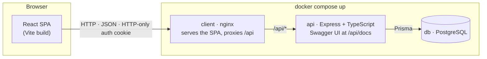
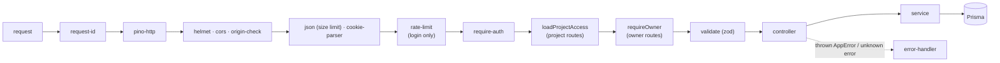
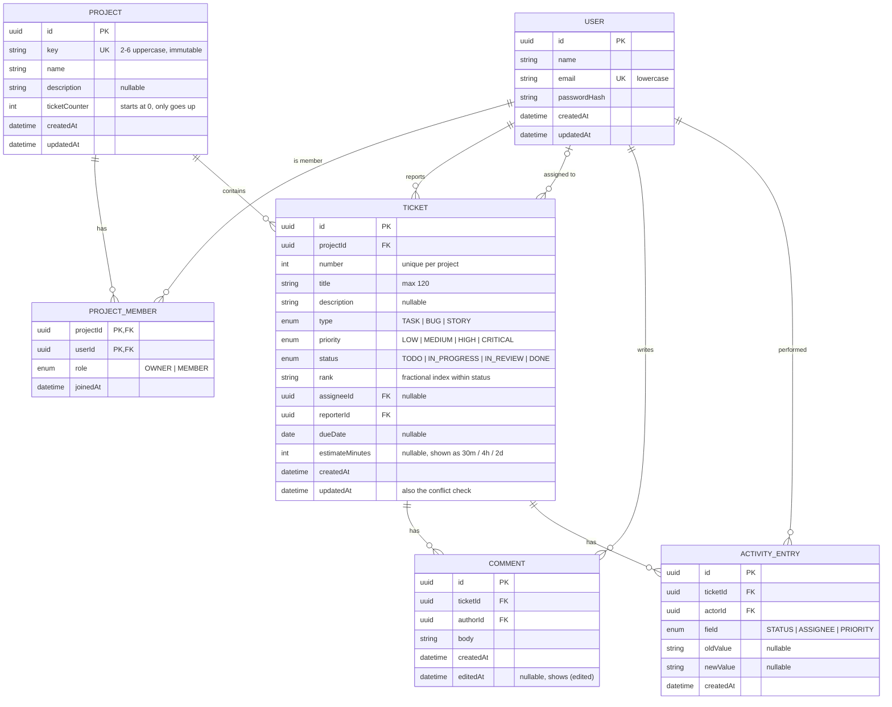

# Mini-Jira — Architecture

**Status:** v1 · 2026-11-17 · all decisions confirmed by the project owner
**Source of truth for requirements:** [mini-jira-requirements.md](../mini-jira-requirements.md)

The defaults proposed in the draft were confirmed on 2026-11-17 (see [§11](#11-confirmed-defaults)). Only the deployment target is still open (week 8).

---

## 1. System overview



- The browser always talks to **one origin**: nginx in Docker, or the Vite dev server in development. Both forward `/api/*` to the API. Same origin means the auth cookie works with `SameSite=Lax` and no cross-site cookie tricks are needed. CORS is still configured with an allowlist (`CLIENT_ORIGIN`) as the requirements ask.
- The API is stateless (JWT in a cookie), so it can be restarted or scaled without losing sessions.
- `docker compose up` starts three services: `client`, `api`, `db`. The API runs `prisma migrate deploy` on start.

## 2. Tech stack

| Layer | Choice | Why |
|---|---|---|
| Runtime | Node.js + TypeScript | One language across server, client, shared code, and tests |
| API | **Express** | Minimal; we build the layering ourselves (see §4), which is good for learning |
| Database | **PostgreSQL** | Relational data (users ↔ projects ↔ tickets ↔ comments), foreign keys, transactions, row locks for ticket keys |
| DB access | **Prisma** | Schema file → migrations + fully typed queries; supports transactions, atomic increments, conditional updates |
| Auth | **JWT in an HTTP-only cookie** | JavaScript can't read the token, so an XSS bug can't steal it (§7) |
| Validation | **zod**, in the shared package | Same rules on server (source of truth) and client (UX only) |
| API docs | OpenAPI generated from the zod schemas, served with Swagger UI | Docs can't drift from the validation rules |
| Frontend | **React** + TypeScript + Vite | Replaces the Angular named in the requirements (confirm with mentor) |
| Styling | **Tailwind CSS + shadcn/ui** (Radix primitives) | Radix gives accessible dialogs, menus, and dropdowns out of the box |
| Server state | TanStack Query | Caching, loading/error states, optimistic updates with rollback (BRD-2) |
| Forms | React Hook Form + zod resolver | Inline field errors, reuses the shared schemas |
| Drag & drop | dnd-kit | Accessible (keyboard sensor), works for columns and reordering |
| Logging | pino + pino-http with a request ID | Structured logs, required by the NFRs |
| Tests | Vitest (unit, integration with Supertest, components with RTL + MSW), Playwright (E2E) | One test runner across workspaces |
| Repo | **npm workspaces** with a shared package | Types, enums, zod schemas, and error codes written once (§3) |
| CI | GitHub Actions: lint, typecheck, test, build on every PR | Required by the NFRs |

Library names other than the bolded decisions are suggestions; agents may propose alternatives, but must ask before switching.

## 3. Repository layout

```
mini-jira/                      (this folder)
├─ package.json                 npm workspaces: shared, server, client, e2e
├─ docker-compose.yml
├─ .env.example                 every env var, no real secrets
├─ .github/workflows/ci.yml
├─ CLAUDE.md
├─ mini-jira-requirements.md
├─ docs/                        architecture.md, design doc, wireframes/
├─ shared/                      @mini-jira/shared
│  └─ src/
│     ├─ enums.ts               TicketType, Priority, Status, Role
│     ├─ schemas/               zod: auth, project, member, ticket, comment, query params
│     ├─ errors.ts              error codes + error response type
│     └─ api-types.ts           response DTOs (Ticket, Project, Page<T>, ...)
├─ server/                      Express API (§4)
├─ client/                      React app (§5)
└─ e2e/                         Playwright tests + specs/ test plans (owned by qa-engineer)
```

Rule: `shared` contains **no runtime dependencies on server or client code** — only types, enums, zod schemas, and constants. Both `server` and `client` depend on it.

## 4. Backend

### 4.1 Folder structure

```
server/
├─ prisma/
│  ├─ schema.prisma
│  ├─ migrations/
│  └─ seed.ts                   demo users, projects, 1,000+ tickets
├─ src/
│  ├─ app.ts                    builds the Express app (exported for Supertest)
│  ├─ server.ts                 starts listening
│  ├─ config/env.ts             reads + validates env vars with zod; fails fast
│  ├─ middleware/
│  │  ├─ request-id.ts          X-Request-Id: reuse incoming or generate
│  │  ├─ require-auth.ts        verifies JWT cookie → req.user
│  │  ├─ project-access.ts      loadProjectAccess, requireOwner (§6)
│  │  ├─ validate.ts            zod for body / params / query
│  │  ├─ origin-check.ts        blocks cross-site POST/PATCH/PUT/DELETE (§7)
│  │  ├─ rate-limit.ts          login limiters (email + IP, and IP)
│  │  └─ error-handler.ts       one error format, no stack traces
│  ├─ modules/
│  │  ├─ auth/                  *.routes.ts · *.controller.ts · *.service.ts
│  │  ├─ projects/
│  │  ├─ members/
│  │  ├─ tickets/               includes board + position
│  │  ├─ comments/
│  │  ├─ activity/
│  │  └─ my-work/
│  ├─ lib/
│  │  ├─ prisma.ts              single PrismaClient
│  │  ├─ errors.ts              AppError subclasses (NotFound, Forbidden, Conflict, ...)
│  │  ├─ pagination.ts
│  │  ├─ rank.ts                fractional-indexing wrapper
│  │  └─ ticket-key.ts          parse/format "WEB-12"
│  └─ openapi/                  builds the spec from shared zod schemas
└─ tests/
   ├─ unit/
   └─ integration/              real PostgreSQL (Docker), DB reset per test file
```

### 4.2 Layers

| Layer | Does | Must not |
|---|---|---|
| **routes** | URL + method → middleware chain → controller | contain logic |
| **controller** | read validated input from `req`, call a service, send the response | touch Prisma |
| **service** | business rules, permission rules that need loaded data, transactions | know about `req` / `res` |
| **Prisma** | data access | — (no separate repository layer; Prisma already is one) |

### 4.3 Request pipeline



## 5. Frontend

### 5.1 Folder structure

```
client/src/
├─ main.tsx · App.tsx           providers + router
├─ api/
│  ├─ client.ts                 fetch wrapper: credentials 'include', parses the error format,
│  │                            401 → redirect to /login
│  └─ query-keys.ts
├─ features/
│  ├─ auth/  projects/  members/  tickets/  board/  list/  comments/  activity/  my-work/
│  │     each: pages, components, hooks (useXxxQuery / useXxxMutation)
├─ components/
│  ├─ ui/                       shadcn/ui components
│  └─ ...                       EmptyState, ErrorState, ConfirmDialog, Avatar, PageSkeleton
├─ lib/                         dates ("5 minutes ago"), cn(), helpers
└─ styles/                      Tailwind entry + design tokens
```

### 5.2 Routes

| URL | Screen | Req |
|---|---|---|
| `/` | Landing page (public); logged-in users are sent to `/projects` | AUTH-1/2 |
| `/login`, `/register` | Landing page with the Log in / Register popup open | AUTH-1/2 |
| `/projects` | My Projects (cards); a project dropdown in the top bar switches projects from any screen | PRJ-2 |
| `/projects/:projectKey/board` | Board | BRD-* |
| `/projects/:projectKey/list?q&status&type&priority&assignee&sort&order&page` | List view — filters live in the URL | LST-* |
| `/projects/:projectKey/tickets/:ticketKey` (e.g. `/projects/WEB/tickets/WEB-12`) | Ticket detail | TKT-2 |
| `/projects/:projectKey/settings` | Edit project, members, delete | PRJ-3/4/5 |
| `/my-work` | My Work | MY-1 |

All routes except `/`, `/login`, and `/register` are behind a `ProtectedRoute` that waits for `GET /api/auth/me`. Screen designs: [docs/wireframes/](wireframes/).

### 5.3 State

| Kind | Where |
|---|---|
| Server data (projects, tickets, comments, ...) | TanStack Query cache |
| Current user | a TanStack Query on `/api/auth/me` |
| List filters, sort, page | URL query string (shareable, LST-3) |
| Form state | React Hook Form |
| Small UI state (open dialogs, etc.) | component state |

No global store (Redux/Zustand) is needed.

## 6. Authorization (design-doc Q4)

The check lives in **one middleware** plus a few service-level rules:

1. `requireAuth` — verifies the JWT cookie, sets `req.user`; otherwise **401**.
2. `loadProjectAccess` — runs on every `/api/projects/:projectKey/...` route. One query loads the project by key **and** the caller's membership. Project missing **or caller not a member → 404** (doesn't reveal that the project exists). Sets `req.project`, `req.membership`.
3. `requireOwner` — on owner-only routes (edit/delete project, add/remove members). Member but not owner → **403**.
4. Service rules that need the loaded record: delete ticket = reporter **or** owner (TKT-4); edit/delete comment = author (CMT-2); assignee must be a project member (TKT-5).
5. Every ticket query is scoped by `req.project.id` (`where: { projectId, number }`), so a ticket from another project can never be reached through this project's URL.

## 7. Authentication

- **Register** (`POST /api/auth/register`): email stored lowercase and unique; password 8–128 chars, hashed with **Argon2id** (at least 19 MiB memory, 2 iterations, 1 thread); duplicate email → `409 EMAIL_TAKEN`. Register also logs the user in (sets the cookie) and lands on My Projects.
- **Login** (`POST /api/auth/login`): wrong email or password → the same `401 INVALID_CREDENTIALS`. An unknown email still runs a hash, so response time doesn't reveal whether the account exists. Failed attempts are rate-limited per **email + IP** (5 per 15 minutes) and per **IP** (100 per day).
- **Cookie:** `httpOnly`, `sameSite: 'lax'`, `secure` in production, `path: '/'`. Holds a signed JWT `{ sub: userId }`. Lifetime 7 days (`JWT_EXPIRES_IN`), no refresh token in the MVP.
- **Session survives refresh** (AUTH-4): on load the client calls `GET /api/auth/me`.
- **Logout:** `POST /api/auth/logout` clears the cookie.
- **CSRF:** three layers. `SameSite=Lax` on the cookie; the `origin-check` middleware on `POST`/`PATCH`/`PUT`/`DELETE` (allows `Sec-Fetch-Site: same-origin`; if that header is missing, `Origin` must exactly match `CLIENT_ORIGIN`; otherwise `403 FORBIDDEN`); and the API only accepts `application/json` bodies.
- **Trade-off vs. localStorage (design-doc Q6):** localStorage is simpler but readable by any injected script; the cookie is invisible to JavaScript but needs SameSite/CORS care. A JWT can't be revoked before it expires — acceptable for this project.

## 8. Data model



Notes:
- **Ticket key** (`WEB-12`) is not stored: it's `project.key + "-" + ticket.number`. The project key **can't be changed** after creation (PATCH accepts only name and description), so ticket keys and shared URLs stay valid.
- **Ownership:** the creator gets a `PROJECT_MEMBER` row with `role = OWNER` in the same transaction that creates the project. One project has exactly one owner; there's no API to change roles.
- **Estimate** (`estimateMinutes`, optional): a guess of how long the ticket takes, stored as minutes and shown as `30m` / `4h` / `2d` (1d = 8h). Parsing and formatting live in `shared/` so server and client agree. No time-spent logging. **⚠ Pending the mentor's OK** — "time tracking" is out of scope in the requirements (§6); if the mentor says no, drop this column and its UI.
- **Cascades (hard delete):** project → members, tickets; ticket → comments, activity entries.
- **Removing a member (PRJ-4):** in one transaction, delete the membership and set `assigneeId = null` on their tickets in that project. The owner can't be removed.

### 8.1 Indexes

| Index | Used by |
|---|---|
| `User.email` unique | login, add member by email |
| `Project.key` unique | every project URL |
| `ProjectMember (projectId, userId)` PK | access check on every project request |
| `ProjectMember (userId)` | My Projects |
| `Ticket (projectId, number)` unique | ticket lookup by key + safety net for key generation |
| `Ticket (projectId, status, rank)` | board columns in order |
| `Ticket (projectId, updatedAt)` | list view default sort |
| `Ticket (assigneeId)` | My Work, unassign on member removal |
| `Comment (ticketId, createdAt)` | comment thread |
| `ActivityEntry (ticketId, createdAt)` | activity history |

Other sort columns aren't indexed up front: with ~1,000 tickets per project they're fast enough. Add an index only when `EXPLAIN ANALYZE` on the seed data shows a need.

## 9. API

Base path `/api`, JSON only. Full contract: Swagger UI at `/api/docs`, raw spec at `/api/openapi.json`.

| Method & path | Who | Notes |
|---|---|---|
| `POST /auth/register` · `POST /auth/login` · `POST /auth/logout` · `GET /auth/me` | public / user | login is rate-limited |
| `GET /projects?q&page` | user | my projects + role + open-ticket count, paginated; optional `q` searches name or key (project dropdown) |
| `POST /projects` | user | `409 PROJECT_KEY_TAKEN` |
| `GET · PATCH · DELETE /projects/:projectKey` | member · owner · owner | |
| `GET /projects/:projectKey/members` | member | |
| `POST /projects/:projectKey/members` `{ email }` | owner | `404 USER_NOT_FOUND`, `409 ALREADY_MEMBER` |
| `DELETE /projects/:projectKey/members/:userId` | owner | unassigns their tickets; owner can't remove themselves |
| `GET /projects/:projectKey/board?assignee&type&priority` | member | per column: count + first page of cards ordered by rank |
| `GET /projects/:projectKey/tickets?q&status&type&priority&assignee&sort&order&page` | member | list view, server-side sort/filter, page size 20 |
| `POST /projects/:projectKey/tickets` | member | generates the key (§10.1) |
| `GET /projects/:projectKey/tickets/:ticketKey` | member | |
| `PATCH /projects/:projectKey/tickets/:ticketKey` | member | body includes the `updatedAt` the client loaded → `409 EDIT_CONFLICT` if stale (§10.3) |
| `PATCH /projects/:projectKey/tickets/:ticketKey/position` `{ status, beforeKey?, afterKey? }` | member | board drag/reorder; server computes the rank (§10.2) |
| `DELETE /projects/:projectKey/tickets/:ticketKey` | reporter or owner | |
| `GET · POST /projects/:projectKey/tickets/:ticketKey/comments` | member | oldest first, paginated |
| `PATCH · DELETE /projects/:projectKey/tickets/:ticketKey/comments/:commentId` | author | edit sets `editedAt` |
| `GET /projects/:projectKey/tickets/:ticketKey/activity` | member | paginated |
| `GET /my-work?includeDone&page` | user | tickets assigned to me across my projects, sorted by project then due date (no due date last); Done tickets excluded unless `includeDone=true`; response also has `overdueCount`; paginated |
| `GET /health` | public | for Docker / deploy health checks |

**Pagination response:** `{ items: T[], page, pageSize, total, totalPages }`. No endpoint returns an unbounded list. The board returns up to 50 cards per column, with "load more" per column (cursor = the last card's rank).

**Errors:** always `{ "error": { "code", "message", "details"? } }`. Codes live in `shared/src/errors.ts`:

| HTTP | Codes |
|---|---|
| 400 | `VALIDATION_ERROR` (with `details[]` per field) |
| 401 | `UNAUTHENTICATED`, `INVALID_CREDENTIALS` |
| 403 | `FORBIDDEN` |
| 404 | `NOT_FOUND`, `USER_NOT_FOUND` |
| 409 | `EDIT_CONFLICT`, `EMAIL_TAKEN`, `PROJECT_KEY_TAKEN`, `ALREADY_MEMBER`, `CANNOT_REMOVE_OWNER` |
| 429 | `RATE_LIMITED` |
| 500 | `INTERNAL_ERROR` (no stack trace; the request ID is logged) |

## 10. Key flows (design-doc answers)

### 10.1 Ticket keys — counter on the project row (Q2)

```
BEGIN
  UPDATE project SET ticketCounter = ticketCounter + 1 WHERE id = $projectId RETURNING ticketCounter   -- n
  rank := key after the last card in the TODO column
  INSERT ticket (projectId, number = n, status = TODO, rank, ...)
COMMIT
```

In Prisma: `tx.project.update({ data: { ticketCounter: { increment: 1 } } })` inside `prisma.$transaction`. The `UPDATE` takes a **row lock** on the project, so two simultaneous creates wait in line and get different numbers. The counter never goes down, so deleted numbers are **never reused**. The unique `(projectId, number)` index is a safety net.

### 10.2 Card order — fractional rank (Q3)

Each ticket has a `rank` string that sorts within its status column. To move a card, the client sends the target `status` and the neighbor keys (`beforeKey` / `afterKey`). The server computes a rank between the neighbors with `fractional-indexing` and updates **only that ticket**. The order is the same for every user and survives refresh (BRD-3).

The client moves the card immediately (optimistic update) and rolls back with an error message if the server rejects it (BRD-2). A status change through `/position` also writes a `STATUS` activity entry. When neither `beforeKey` nor `afterKey` is sent, the ticket goes to the **bottom** of the target column — this is how the one-click status dropdown on the ticket page uses the same endpoint (wireframe 04).

Board moves **don't** use the edit-conflict check ("last move wins"), so dragging never fails just because someone edited the title. They do change `updatedAt`, so an open edit form elsewhere will get a 409 on save.

### 10.3 Concurrent edits — `updatedAt` check (Q5, CON-1)

```
BEGIN
  current := SELECT ticket (for old values)
  count := UPDATE ticket SET ..., updatedAt = now()
           WHERE id = $id AND updatedAt = $updatedAtFromClient
  IF count = 0 → ROLLBACK → 409 EDIT_CONFLICT (or 404 if the ticket is gone)
  INSERT activity entries for changed status / assignee / priority
COMMIT
```

In Prisma: `tx.ticket.updateMany({ where: { id, updatedAt } })` and check `count`. **Why the timestamp is safe here:** Prisma stores `DateTime` in PostgreSQL as `timestamp(3)` (milliseconds), the same precision as a JavaScript `Date`. The ISO string sent to the client therefore comes back exactly equal. Rules: never change the column's precision, and the client must send back the exact `updatedAt` string it received. The client shows "This ticket was updated by someone else" with a **Reload** button and keeps the user's typed input.

### 10.4 Activity log — same transaction (Q7)

Activity entries are written **in the same transaction** as the ticket change (10.2, 10.3). If either fails, both roll back, so the history can't miss a change or record one that didn't happen.

### 10.5 Hard delete (Q8)

Tickets are hard-deleted. Comments and activity entries are deleted with them by `ON DELETE CASCADE`. Deleting a project removes all its tickets, comments, and members (PRJ-5). Keys stay unique because the counter only goes up. Trade-off: no undo and no history of deleted tickets, which the requirements don't ask for.

### 10.6 Summary for the design doc

| # | Question | Answer |
|---|---|---|
| 1 | MongoDB or PostgreSQL? | PostgreSQL: relational data, FKs + cascades, transactions, row locks (§2) |
| 2 | Ticket keys | Atomic counter on the project row inside a transaction (§10.1) |
| 3 | Card order | Fractional rank string, one row updated per move (§10.2) |
| 4 | Access check | `loadProjectAccess` middleware + service rules; queries scoped by project (§6) |
| 5 | Conflict detection | Conditional update on `updatedAt` → 409 (§10.3) |
| 6 | Token storage | JWT in an HTTP-only cookie (§7) |
| 7 | Activity log atomicity | Same transaction as the change (§10.4) |
| 8 | Soft or hard delete | Hard delete with cascades (§10.5) |

## 11. Confirmed defaults

Confirmed by the project owner on 2026-11-17. Changing any of these is an architecture change: ask first, then update this doc and `CLAUDE.md`.

| # | Decision | Alternative that was rejected | Status |
|---|---|---|---|
| 1 | Project key can't be changed after creation | Allow changing it (breaks old ticket URLs) | ✅ Confirmed |
| 2 | Board moves don't use the conflict check ("last move wins") | Also send `updatedAt` on moves → drags can fail with 409 | ✅ Confirmed |
| 3 | Non-members get **404**, members without rights get **403** | 403 for both | ✅ Confirmed |
| 4 | Register logs the user in | Redirect to the login page after register | ✅ Confirmed |
| 5 | Board returns up to 50 cards per column, "load more" per column | All cards at once (breaks "never unbounded") | ✅ Confirmed |
| 6 | Auth cookie lasts 7 days, no refresh token | Shorter lifetime + refresh token | ✅ Confirmed |
| 7 | Deployment target is chosen in week 8 (e.g. Render, Railway, Fly.io) | Choose now | ✅ Confirmed — target still **open** |
| 8 | Passwords hashed with **Argon2id** (OWASP's first choice) | bcrypt | ✅ Confirmed 2026-11-18 |
| 9 | CSRF: `SameSite=Lax` **plus** an `origin-check` middleware | `SameSite=Lax` only | ✅ Confirmed 2026-11-18 |
| 10 | Failed logins limited per **email + IP** and per **IP** | Per IP only | ✅ Confirmed 2026-11-18 |
| 11 | Card `⋯` menu has **Move up / Move down**, so reordering works without dragging (WCAG 2.5.7) | Drag or keyboard only | ✅ Confirmed 2026-11-18 |

Coding rules for this architecture: [engineering-standards.md](engineering-standards.md).

## 12. Operations

- **Environment variables** (`.env.example`): `DATABASE_URL`, `JWT_SECRET`, `JWT_EXPIRES_IN`, `CLIENT_ORIGIN`, `PORT`, `NODE_ENV`, `LOG_LEVEL`. Validated at startup; the API refuses to start if one is missing.
- **Logging:** pino JSON logs; every line has the request ID, which is also returned in the `X-Request-Id` header.
- **Seed:** `server/prisma/seed.ts` creates demo users, several projects, 1,000+ tickets with ranks, comments, and activity.
- **CI (GitHub Actions, every PR):** install → lint → typecheck → unit + integration tests (PostgreSQL service container) → build. E2E (Playwright) runs against `docker compose`.
- **Testing layers:** unit (rank, ticket-key parsing, permission rules) · integration (every endpoint incl. 401/403/404/409 paths) · component (forms, states, optimistic board) · E2E (critical journeys). Details in the agent files.
