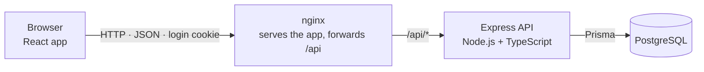
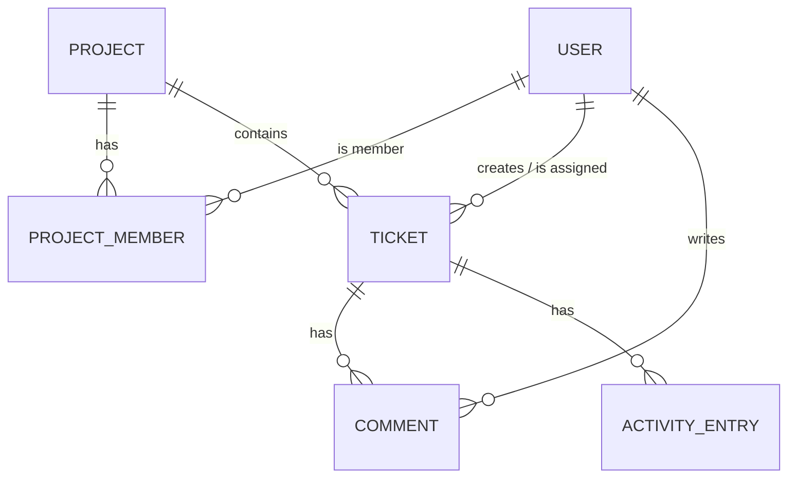

# Mini-Jira — Design Doc

**Author:** Orel Tzarfaty · **Date:** 2026-11-18 · **Status:** Ready for mentor review
**Full technical details:** [architecture.md](architecture.md) · Screens: [wireframes/](wireframes/README.md) · Plan: [backlog.md](backlog.md)

---

## 1. Overview

Mini-Jira is a lightweight task board for small teams. Users register, create projects, add teammates by email, and track work as tickets (Task / Bug / Story) on a drag-and-drop board with four statuses (To Do, In Progress, In Review, Done). Tickets have comments and an activity history. A user sees only the projects they belong to; each project has one **owner** (full control) and **members**.

**Stack:** React + TypeScript (client) · Node.js + Express + TypeScript (API) · PostgreSQL + Prisma (database) · Docker Compose · GitHub Actions CI.

**Changes from the requirements (to confirm with the mentor):**
- **React instead of Angular** for the client.
- An optional **Estimate** field on tickets (`30m` / `4h` / `2d`) — a guess only, no time logging, since "time tracking" is out of scope.

## 2. Architecture

- The browser talks to **one address**; nginx forwards `/api` calls to the API. This keeps the login cookie simple and safe.
- The API is split into layers: **routes → controllers → services → database**. Permission checks live in middleware (see Q4).
- Validation rules are written once in a **shared** package and used by both the client and the server.

## 3. Data model

| Table | Main fields |
|---|---|
| User | name, email (unique), password hash |
| Project | key (`WEB`, unique, can't change), name, description, `ticketCounter` |
| ProjectMember | project, user, role (OWNER / MEMBER) |
| Ticket | project, number (→ `WEB-12`), title, description, type, priority, status, `rank`, assignee, creator, due date, estimate, `updatedAt` |
| Comment | ticket, author, text, edited at |
| ActivityEntry | ticket, who, field (status / assignee / priority), old value → new value, when |

---

## 4. Design questions

### Q1 · MongoDB or PostgreSQL? Why, for this data model?

**Decision:** PostgreSQL.

PostgreSQL is a good choice because our data is connected. For example, one ticket can have many comments. It also supports transactions.

### Q2 · How do you generate ticket keys (`WEB-13`) so two simultaneous creates never get the same number?

**Decision:** a counter on the project row, increased inside a transaction.

The best way to do this is with a lock. We lock the counter, only on the row of the project in the request. When the request finishes, we unlock it for the next request. When a ticket is deleted, the counter stays the same, so two tickets never get the same number.

### Q3 · How do you store card order within a column so reordering doesn't update every ticket?

**Decision:** a fractional "rank" string per ticket.

We save a rank on each ticket because we want a card to stay in the place we moved it to after sorting. When a card moves, we update only that ticket. This is better than changing every ticket to sort them again, which is not efficient.

### Q4 · How does the server decide whether a user may access a ticket? Where does that check live?

**Decision:** one middleware that checks project membership, plus a few rules in the services.

The server checks that the user has a valid JWT token. Then it looks in the database to check the user's role in the project. If the user isn't a member of the project, the server returns 404 and they can't do anything. We write this check in one place so we don't forget it.

### Q5 · How do you detect the concurrent-edit conflict (CON-1)?

**Decision:** compare the ticket's `updatedAt` when saving.

When a user saves, the browser sends the new ticket data and the update time it loaded. The server saves the ticket only if the update time is still the same. If it isn't the same, the server returns 409 Conflict.

### Q6 · JWT in local storage vs. HTTP-only cookie — which did you choose and what are the trade-offs?

**Decision:** JWT in an HTTP-only cookie.

We keep the token in an HTTP-only cookie because JavaScript can't read it, so an attacker can't steal the token. The downside is that the browser sends the cookie automatically, so another website could send requests for the user. We protect against this with the `SameSite=Lax` cookie setting. We also check where the request comes from, and if it comes from another website, the server blocks it with 403.

### Q7 · Is the activity log written in the same operation as the ticket update? What if one fails?

**Decision:** yes — the same database transaction.

We save the ticket change and the activity log in one transaction, so if one of them fails, we roll back the change that we did.

### Q8 · Soft delete or hard delete for tickets? Why?

**Decision:** hard delete.

We use hard delete because it is easier: we don't need to check in every query whether a ticket was deleted.
